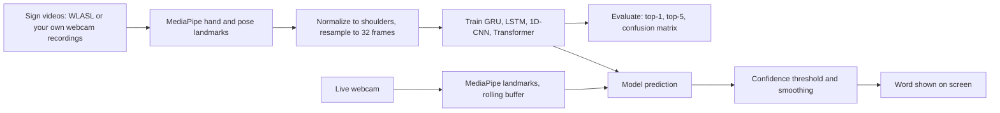

# Real-Time Sign Language Recognition

   

Recognises **isolated sign language words** from a webcam in real time. MediaPipe extracts hand and upper-body landmarks from each frame, a sequence model classifies the sign, and the predicted word appears on screen.

> Add a demo GIF here: `docs/demo.gif`

## How it works



1. **Landmarks**: per frame, 21 points per hand (2 hands) plus shoulders, elbows and wrists = 48 points × (x, y, z) = **144 features**. Undetected parts are zeros.
2. **Normalization**: coordinates are centred on the shoulder midpoint and scaled by shoulder width, so the model does not depend on where you stand or how far you are from the camera.
3. **Sequences**: every sample is resampled to a fixed length (default 32 frames).
4. **Augmentation**: random temporal crop, small rotation, scaling, shift and noise on the landmarks (no mirroring, because many signs are not left/right symmetric).
5. **Models**: bidirectional GRU, bidirectional LSTM, 1D-CNN and a small Transformer encoder, all compared on the same split.
6. **Live inference**: a rolling window of webcam frames is classified every few frames. A word is shown only when the confidence is above a threshold and the same prediction repeats several times in a row, so the text does not flicker.

## Results

Fill these in after you train on your data (`outputs/model_comparison.md`, `outputs/<model>/metrics.json`).

| Model | Top-1 | Top-5 | Parameters |
|---|---|---|---|
| GRU | _your result_ | _your result_ | |
| LSTM | _your result_ | _your result_ | |
| 1D-CNN | _your result_ | _your result_ | |
| Transformer | _your result_ | _your result_ | |

Dataset used: _e.g. WLASL, top 100 glosses by available videos_ · Split: _the dataset's train/val/test split_

## Quick start

```bash
git clone https://github.com/<your-username>/sign-language-recognition.git
cd sign-language-recognition
python -m venv .venv && source .venv/bin/activate    # Windows: .venv\Scripts\activate
make install                                          # or: pip install -r requirements.txt && pip install -e .
python -m signlang.download_models                    # one-time MediaPipe model files (~15 MB)
```

### Option A: your own signs (fastest way to a working demo)

Record 10-20 signs, about 30-50 samples each, with your webcam:

```bash
python -m signlang.record_samples --label hello --n 40
python -m signlang.record_samples --label thanks --n 40
# repeat for each sign. SPACE records one sample, Q quits
python -m signlang.train --model gru
python -m signlang.realtime --model-dir outputs/gru
```

Tip: vary distance, lighting, speed and background between samples. Samples are split randomly per class, so scores on your own recordings are optimistic (the same person and room appear in train and test). Say so when you report them.

### Option B: WLASL dataset

1. Get the WLASL metadata (`WLASL_v0.3.json`) and the videos from the [official WLASL project](https://github.com/dxli94/WLASL) or a processed copy such as one on Kaggle. Many of the original links are dead, so use whatever videos you can obtain, and check the dataset's terms of use. Do not redistribute the videos.
2. Put the videos in a folder, named `<video_id>.mp4`.
3. Run:
   ```bash
   python -m signlang.prepare_wlasl --wlasl-json WLASL_v0.3.json --videos-dir videos --top-k 100
   python -m signlang.extract_landmarks --config config.yaml
   python -m signlang.train --model all        # trains and compares all four models
   python -m signlang.realtime --model-dir outputs/gru
   ```

`--top-k` keeps the glosses that have the most videos *available to you*, so the vocabulary is not identical to the published WLASL100 subset and results are not directly comparable with papers.

## Project structure

```
├── config.yaml
├── src/signlang/
│   ├── landmarks.py          # MediaPipe hand + pose extraction
│   ├── features.py           # normalization, resampling (pure NumPy)
│   ├── augment.py            # landmark augmentation
│   ├── prepare_wlasl.py      # video manifest from WLASL
│   ├── extract_landmarks.py  # videos -> cached .npy landmarks
│   ├── record_samples.py     # record your own signs
│   ├── data.py               # loading and splitting
│   ├── models.py             # GRU / LSTM / CNN / Transformer
│   ├── train.py              # training, evaluation, comparison
│   ├── inference.py          # model loading and prediction
│   ├── smoothing.py          # confidence + consensus smoothing
│   └── realtime.py           # live webcam demo
├── tests/
├── data/                     # landmarks (git-ignored)
└── outputs/                  # trained models, metrics, plots
```

## Known limitations

- Recognises **isolated words only**, not sentences or sign language grammar. Sign languages also use facial expression and non-manual markers, which this project mostly ignores.
- Accuracy on in-the-wild datasets such as WLASL is limited with a simple landmark model, and it depends heavily on the vocabulary size and the signers. A model trained on your own recordings may not work well for other people.
- Webcam conditions (lighting, framing, background, camera angle) differ from the dataset videos, so test live early.
- Signs that look similar (same handshape, different movement or location) are the most common confusions. Check `most_confused` in `metrics.json`.
- This is a learning and portfolio project, not an accessibility or communication tool.

## Ideas for extension

- Add face landmarks and compare the effect on accuracy.
- Signer-independent evaluation (hold out entire signers).
- Continuous recognition with sliding-window detection of sign start and end.
- Export to TensorFlow Lite / run in the browser with MediaPipe Web.

## Credits and licences

- [MediaPipe](https://github.com/google-ai-edge/mediapipe) (Apache 2.0).
- WLASL: Li et al., "Word-level Deep Sign Language Recognition from Video" (WACV 2020). Check the dataset's licence before use.

## Resume line

> Built a real-time sign language recognition system using MediaPipe landmarks and a sequence model trained on WLASL, with live webcam inference.

## License

MIT, see [LICENSE](LICENSE).
